# 🤖 Awesome Hardware AI Agents 🦾

  
  
  
  
  
  

  

### 🌐 The Definitive Directory of Wearable AI Devices, Microcontroller Agent Runtimes & Physical Computing AI 🚀

*Track top commercial SaaS platforms, self-hosted hardware assistants, embedded microcontroller runtimes (ESP32 / RP2040), and open-source device revivals.*

**Last updated: October 2026** 📅

---

## 🧭 Overview & Key Capabilities 💡

**Hardware AI Agents** merge autonomous foundation models (LLMs, VLMs, LAMs, and real-time audio streams) with physical embedded devices—smart glasses 👓, AI pendants 🎙️, smart pins 📌, mixed reality headsets 🥽, and microcontrollers ⚡. These physical agents interact with surroundings, see through embedded camera lenses, listen with beamforming microphone arrays, reason locally or via low-latency cloud backends, and take physical or digital actions on behalf of users.

### 🌟 Highlights & Focus Areas
- 🧠 **Wearable Lifeloggers & Pendants**: Continuous ambient recording, transcription, contextual recall, and real-time summaries.
- 👓 **Smart Eyewear & Spatial Computing**: AR heads-up displays, multimodal visual query engines, and gaze/gesture tracking.
- ⚡ **Embedded MCU Runtimes**: Running agent reasoning loops, tool calling, vector search, and MCP protocols directly on $5 chips (ESP32-S3, RP2040).
- 🛠️ **Open-Source Device Revival**: Resurrecting abandoned or bricked proprietary hardware into sovereign, local-first agent tools.

---

## 📑 Table of Contents 📖

- [📊 Sector Overview & Market Dynamics](#-sector-overview--market-dynamics)
- [🏢 SaaS & Hosted Commercial Platforms](#-saas--hosted-commercial-platforms)
- [🔓 Top Open-Source Hardware AI Projects](#-top-open-source-hardware-ai-projects)
- [🤝 How to Contribute](#-how-to-contribute)
- [💖 Support & Sponsorship](#-support--sponsorship)
- [⚠️ Disclaimer](#️-disclaimer)
- [📈 Star History](#-star-history)

---

## 📊 Sector Overview & Market Dynamics 📈

The global wearable AI and hardware agent market is currently estimated at **USD $35B–$45B** and projected to surge past **USD $200B+ by the 2030s**, compounding at an aggressive CAGR of **25%–35%**. 

The sector is **moderately to highly fragmented**:
- 🏛️ **Ecosystem Big-Tech Dominance**: Tech giants like **Apple** and **Meta** anchor large-scale consumer hardware distribution by baking proprietary foundation models (Apple Intelligence, Meta AI) directly into daily spatial and audio wear.
- 🦄 **Nimble Startup Innovation**: Startups drive rapid category experimentation across wearable audio pendants, clip-on vision pins, and developer-friendly AR monocles.
- 🧩 **Emerging Protocol Standardization**: Hardware agent execution is shifting toward open connectivity standards (such as **Model Context Protocol [MCP]** and on-device agent loops) to bridge proprietary walled gardens and prevent hardware obsolescence.

---

## 🏢 SaaS & Hosted Commercial Platforms 💼

*Commercial hardware AI products, categorized and sorted by company size (Valuation / Market Capitalization / Revenue in descending order).*

| Company / Product 🏷️ | Valuation / Revenue 💰 | Starting Pricing Tier 💳 | Free Tier Limits 🎁 | Description 📝 |
| :--- | :--- | :--- | :--- | :--- |
| **[Apple Vision Pro](https://www.apple.com/apple-vision-pro/)** (Apple) 🍎 | **~$3.5T Market Cap** / $391B Annual Revenue | $99/year (Apple Developer Program starting tier; hardware starts at $3,499) | Xcode SDK & visionOS simulator free forever; on-device personal testing free without App Store distribution | Spatial computing headset with dual micro-OLED displays, high-speed eye/hand tracking, and native spatial AI workflows. |
| **[Meta Quest 3](https://www.meta.com/quest/)** (Meta Platforms) 🥽 | **~$1.7T Market Cap** / $164B Annual Revenue | $7.99/month (Meta Quest+ / Horizon+ game & app catalog subscription) | 1-month free trial for standalone signups; 3 to 6-month free trial bundled with eligible headset purchases | Mixed reality headset featuring high-resolution color passthrough, hand tracking, and integrated Meta AI assistance. |
| **[Ray-Ban Meta](https://www.meta.com/smart-glasses/)** (Meta Platforms / EssilorLuxottica) 👓 | **~$1.7T Market Cap** (Meta) / $164B Annual Revenue | $19.99/month (Meta One Premium for expanded AI audio features) | 3 hours/month free for AI Conversation Focus voice isolation; standard capture/voice queries free forever | Smart glasses with built-in camera, spatial audio array, and multimodal Meta AI voice query integration. |
| **[Plaud Note](https://www.plaud.ai/)** (Plaud / Nicebuild) 🎙️ | **~$1B–$2B Valuation** / $100M ARR | $17.99/month (or $99.99/year for Plaud Pro) | 300 minutes/month free transcription & summarization resets monthly on Starter plan | Ultra-slim credit-card AI voice recorder with transcription in 112+ languages, speaker labels, and custom summary templates. |
| **[Humane AI Pin](https://humane.com/)** (Acquired by HP) 📌 | **$116M Acquisition Price** ($850M Peak Private Valuation) | $24/month (Humane monthly service plan; discontinued post-HP buyout) | 90-day free trial initially bundled with hardware purchase before service shutdown (now requires community servers like OpenPin) | Screenless wearable pin with laser projection display and cloud multimodal AI. Acquired by HP in early 2025. |
| **[Rabbit R1](https://www.rabbit.tech/)** (Rabbit Inc.) 🐰 | **~$30M Total Funding** Raised (Venture-backed) | $0/month (No recurring subscription; $199 one-time hardware purchase) | Free forever with no token caps for core OS queries, translations, and summaries (user provides cellular SIM/data) | Standalone AI companion device with rotating camera, push-to-talk button, and cloud Large Action Model navigation. |
| **[Brilliant Monocle](https://brilliant.xyz/)** (Brilliant Labs) 🧐 | **~$6M Total Funding** Raised (Venture-backed) | $0/month introductory tier (Planned future paid tiers for high-volume API use) | Free daily usage cap for multimodal queries/translations via the Noa companion app | Open-source-friendly wearable monocle with an AR micro-OLED display, MicroPython firmware, and open developer APIs. |
| **[Limitless Pendant](https://www.limitless.ai/)** (Acquired by Meta) 📿 | **~$350M Peak Valuation** (Acquired by Meta in late 2025) | $19/month (Limitless Pro subscription for power users) | 1,200 minutes (20 hours)/month free voice transcription and lifelog search on Free tier | Wearable AI pendant focused on ambient listening, meeting summaries, and conversational lifelog memory. |

---

## 🔓 Top Open-Source Hardware AI Projects 🛠️

*The premier open-source repositories for building physical AI agents, running local MCU runtimes, and reviving commercial wearables. Sorted in **descending order by GitHub Stars_Count**.*

| Project & Repo Link 🚀 | GitHub_Stars 🌟 | Target Hardware 🖥️ | Primary Capabilities 🔍 |
| :--- | :--- | :--- | :--- |
| **[OMI (OpenGlass / Friend)](https://github.com/BasedHardware/omi)**   `BasedHardware/omi` |  | Custom Wearable PCB, ESP32, iOS/Android | AI that sees your surroundings, listens to your conversations, and proactive notes/memories. Complete open hardware schematic, 3D casing, and open app. |
| **[01 Project](https://github.com/OpenInterpreter/01)**   `OpenInterpreter/01` |  | ESP32, Raspberry Pi, Desktop | The #1 open-source voice interface for desktop, mobile, and ESP32 hardware. Runs an autonomous voice agent loop to control computers and edge devices locally. |
| **[ESP32 iPhone Agent](https://github.com/onehumanbeing/esp32-iphone-agent)**   `onehumanbeing/esp32-iphone-agent` |  | $7 ESP32-S3 + iPhone | Uses a $7 ESP32-S3 as AirPlay receiver (eyes) and USB HID mouse/keyboard (hands) while an on-device app streams frames to vision models to tap, swipe, and automate iOS apps without jailbreak. |
| **[Owl Wearable AI](https://github.com/OwlAIProject/Owl)**   `OwlAIProject/Owl` |  | Wearable Audio Hardware, Linux, Mobile | A personal wearable AI capturing continuous audio and conversational context with privacy-preserving local processing. |
| **[Frame Codebase](https://github.com/brilliantlabsAR/frame-codebase)**   `brilliantlabsAR/frame-codebase` |  | Brilliant Labs Frame Smart Glasses | The complete open-source firmware, Bluetooth protocol, and app framework powering Brilliant Labs Frame AI glasses. |
| **[Monocle MicroPython](https://github.com/brilliantlabsAR/monocle-micropython)**   `brilliantlabsAR/monocle-micropython` |  | Brilliant Labs Monocle AR | MicroPython ported directly to the Monocle AR pocket device with camera, display, and Bluetooth LE API access. |
| **[PycoClaw](https://github.com/jetpax/pycoclaw)**   `jetpax/pycoclaw` |  | ESP32-S3 (8MB Flash + PSRAM) | Complete MicroPython autonomous agent loop on a $5 chip: recursive tool calling, context compaction, persistent TF-IDF vector memory on SD, and multi-model routing. |
| **[Clawsses](https://github.com/dweddepohl/clawsses)**   `dweddepohl/clawsses` |  | Rokid Smart Glasses + OpenClaw | Voice-first wearable AI connecting smart AR glasses directly to an autonomous agent loop for instant conversational and visual assistance. |
| **[OpenPin](https://github.com/MaxMaeder/OpenPin)**   `MaxMaeder/OpenPin` |  | Humane AI Pin (Custom Interposer PCB) | Revives bricked Humane AI Pins via a custom hardware interposer and self-hosted server replacement after official cloud servers were shut down. |
| **[Foqsee/S1-app](https://github.com/Foqsee/S1-app)**   `Foqsee/S1-app` |  | Android & iOS Smartphones | An open-source alternative to the Rabbit R1 running directly on standard phones, replicating physical companion LAM navigation without proprietary hardware. |
| **[Bubbaloop](https://github.com/kornia/bubbaloop)**   `kornia/bubbaloop` |  | Raspberry Pi, Jetson, Linux | Single Rust binary for cameras, sensors, and robotics orchestrated by autonomous AI agents with spatial memory and real-time telemetry. |
| **[ESP-Claw](https://github.com/Xinyuan-LilyGO/esp-claw)**   `Xinyuan-LilyGO/esp-claw` |  | LilyGO ESP32-S3 / P4 / C5 / S31 | C-based Chat-Coding AI agent runtime for IoT devices with instant event loops, multi-IM integrations, and Model Context Protocol (MCP) Client/Server. |
| **[Open Study Buddy](https://github.com/dmccreary/open-study-buddy)**   `dmccreary/open-study-buddy` |  | Raspberry Pi Pico 2 W + Round Display | Interactive textbook and firmware for constructing a low-cost, open educational voice AI companion using MicroPython. |

---

## 🤝 How to Contribute 💡

Contributions from makers, embedded engineers, and hardware AI enthusiasts are warmly welcome! 🙌

1. 🍴 **Fork the repository**.
2. 🌿 **Create a feature branch**: `git checkout -b add/new-hardware-agent`.
3. 📝 **Add your entry** to either the SaaS table or Open-Source table, ensuring:
   - Factual, clear description.
   - Verified GitHub repo link and social Stars_Badge linked to the stargazers page.
   - Specific pricing and free tier/trial limits for SaaS products.
   - Proper Stars_Count sorting order.
4. 🚀 **Submit a Pull Request** with a brief summary of the project.

---

## 💖 Support & Sponsorship ☕

Thank you for exploring and building with **Awesome Hardware AI Agents**! ❤️

Building and maintaining this open resource takes dedicated research across hardware ecosystems, microcontrollers, and agent architectures. If this curated repository has helped your research, DIY hardware project, or startup:

- ⭐ **Star this repository** to help others discover it!
- 🍴 **Fork and share** with your hardware, IoT, and maker communities.
- ☕ **Buy me a coffee / Sponsor**: If you would like to support ongoing updates, tool tests, and maintenance, please consider sponsoring via the [GitHub Sponsors Dashboard](https://github.com/sponsors/ishandutta2007) 🙏.

Your support keeps open-source physical computing alive and kicking! 🦾✨

---

## ⚠️ Disclaimer 🛡️

- 📌 This list is **community-curated** for educational, engineering, and research purposes and does not constitute commercial endorsement.
- ☁️ **Cloud Dependency & Vendor Risk**: Proprietary hardware devices (e.g., Rabbit R1, Limitless, Humane) depend on centralized vendor clouds. If servers sunset, hardware functionality may degrade or brick unless community revival frameworks (e.g., OpenPin) are deployed.
- ⚡ **Microcontroller Feasibility**: MCU runtimes (PycoClaw, ESP-Claw) demonstrate edge reasoning capability within microcontroller memory constraints (no dedicated on-chip LLM inference GPU).
- 🔒 **Security Considerations**: Review network exposure, HID automation privileges, and token scopes before deploying microcontroller hardware agents in security-sensitive production setups.

---

## 📈 Star History 📊

---

**Crafted with 🦾 for embedded engineers, hardware makers, and autonomous agent builders.**  
*Let's make hardware AI agents open, accessible, and sovereign!* 🚀

